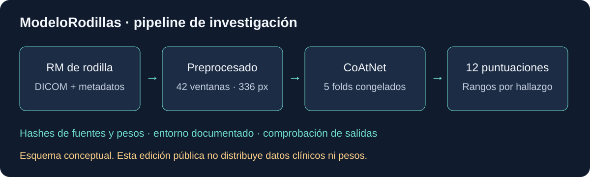

# RSNA Knee Abnormality Detection

### Aprender a mirar, construir y aceptar los límites

Detrás de una resonancia de rodilla hay una persona. Aquí trabajamos con imágenes, código y números, pero el contexto de salud merece estar presente desde el principio: reconocer un patrón en una competición es solo una pequeña parte del camino hacia algo que pueda ayudar a alguien.

RSNA Knee Abnormality Detection reúne el trabajo realizado para explorar la detección de doce hallazgos en resonancias de rodilla, dentro de una competición de Kaggle. Este repositorio cuenta ese recorrido: lo que se consiguió construir, lo que se torció y las lecciones que quedan después de cerrar una entrega.

## Un camino de pruebas y decisiones

El reto parecía concreto: enseñar a un modelo a encontrar señales en imágenes médicas. Llevarlo hasta una entrega exigió mucho más que entrenarlo. Hubo que preparar las imágenes, comparar alternativas, cuidar un presupuesto de cómputo gratuito y comprobar que cada resultado correspondía a la versión que se quería evaluar.

Una parte importante del esfuerzo estuvo en ese trabajo poco visible: volver sobre una comprobación, entender una diferencia, dejar constancia de un fallo. Son tareas que rara vez aparecen en una puntuación, pero que permiten confiar un poco más en lo que se está haciendo.

El proyecto se apoyó en trabajo abierto de otras personas y añadió desarrollo propio. Las [atribuciones](THIRD_PARTY_NOTICES.md) y la [procedencia del código](docs/provenance.json) recogen esa deuda.

## El resultado, con perspectiva

El modelo propio llegó a Kaggle, fue aceptado y quedó seleccionado como entrega final. Su puntuación pública fue **0,869**, frente a un líder que rondaba **0,969** el **18 de octubre de 2026**. Quedó lejos de los primeros puestos.

Después de tanto trabajo, esa distancia también forma parte de la historia. Una entrega que funciona no garantiza el resultado que se esperaba. Aun así, el recorrido deja algo valioso: práctica para construir, criterio para evaluar y una idea más clara de lo que habría que mejorar.

También quedó una dificultad sin resolver. Una segunda alternativa, llamada N1, tuvo un error durante el envío y no se pudo confirmar su aceptación. Se conservó el registro y se decidió no repetir la solicitud para evitar duplicados. La entrega final quedó únicamente con CoAtNet.

Estos resultados describen una competición y sus comprobaciones internas. **El proyecto es experimental y no está validado para tomar decisiones clínicas.** Los detalles y límites están en la [ficha del modelo](docs/model-card.md).

## Lo que queda del aprendizaje

Comparar modelos enseñó a distinguir una mejora interna de una mejora frente a otros equipos. Revisar resultados enseñó que una muestra pequeña puede dar una confianza mayor de la que merece. Y el fallo de N1 dejó una lección concreta: guardar que algo falló no basta; hace falta conservar información útil para entender por qué.

Cerrar el proyecto también supuso aceptar hasta dónde llegaba la evidencia. Quedaron preguntas abiertas y líneas de investigación pendientes. Dejarlas escritas permite que quien llegue después entienda tanto las decisiones como sus límites.

La [retrospectiva](docs/project-retrospective.md) desarrolla estos aprendizajes.

## Explorar el trabajo

Esta edición pública comparte una selección de código, una plantilla del modelo final y **36 pruebas con datos artificiales**. Permite acercarse a algunas de las decisiones del proyecto sin acceder a información privada.

No incluye resonancias, informes, identificadores de pacientes, predicciones, pesos del modelo ni credenciales. La plantilla necesita configuración, datos y pesos autorizados por separado; las pruebas públicas no reproducen el entrenamiento ni la puntuación de Kaggle.

Para ejecutar esas pruebas con Python 3.11:

```sh
python -m venv .venv
# Windows: .venv\Scripts\activate
# Linux/macOS: source .venv/bin/activate
python -m pip install -r requirements-demo.txt
python -B -m unittest tests.test_coatnet_tie_metrics tests.test_coatnet_tie_auc_bound
```

No requieren GPU ni acceso a Kaggle. El [alcance de reproducción](docs/reproducibility.md) explica qué comprueban y qué queda fuera.

<details>
<summary>Ver el recorrido técnico y las comprobaciones</summary>



La plantilla final utiliza CoAtNet con cinco particiones de entrenamiento, checkpoints de época 8, resolución efectiva de 336 y 42 ventanas. Combina resultados mediante rangos por hallazgo, sin TTA ni entrenamiento durante la inferencia. El nombre del backbone es `coatnet_rmlp_2_rw_384.sw_in12k_ft_in1k`; el 384 de ese nombre no es la resolución usada. El archivo `kaggle/53_coatnet_final_inference/infer_coatnet.py` conserva `CONFIG = {}`. Las fuentes 22/36 son referencias históricas, no entregas finales ni una fusión entregada.

La comparación interna sobre 4349 estudios weak O2 dio 0,780478 para CoAtNet y 0,704753 para N1. En los 58 estudios gold, los valores fueron 0,836965 y 0,720249. Se utilizó bootstrap pareado con 2000 remuestreos. El conjunto gold era pequeño y ya había intervenido en el desarrollo; esta comparación no demuestra superioridad clínica ni aísla el efecto de la arquitectura.

Las reproducciones desde ZIP generaron archivos idénticos en tres estudios visibles. Un benchmark separado cubrió 1500 estudios y 8303 series. Estas comprobaciones no acreditan el tiempo del conjunto oculto ni la reproducción completa del entrenamiento.

El envío propio seleccionado fue el **57319469**. El mejor resultado histórico de la cuenta, 0,924, procedía de una referencia pública externa y no corresponde al modelo propio. La clasificación pública usaba aproximadamente el 30 % del test y la privada el 70 % restante; la posición final podía cambiar. Kaggle advertía de selección automática con menos de dos plazas: solo se confirmó la selección explícita de CoAtNet en la fecha indicada.

Fuentes: [competición y envíos](https://www.kaggle.com/competitions/rsna-knee-abnormality-detection/submissions), [clasificación pública](https://www.kaggle.com/competitions/rsna-knee-abnormality-detection/leaderboard) y [ficha del modelo](docs/model-card.md). Los recibos privados no se publican; las cifras de la campaña son un resumen documental y no pueden comprobarse íntegramente desde este repositorio.

</details>

**Licencia:** [Apache-2.0](LICENSE), con [atribuciones y exclusiones](THIRD_PARTY_NOTICES.md) y [NOTICE](NOTICE). El acceso a datos y pesos de la competición requiere cumplir sus condiciones por separado.
